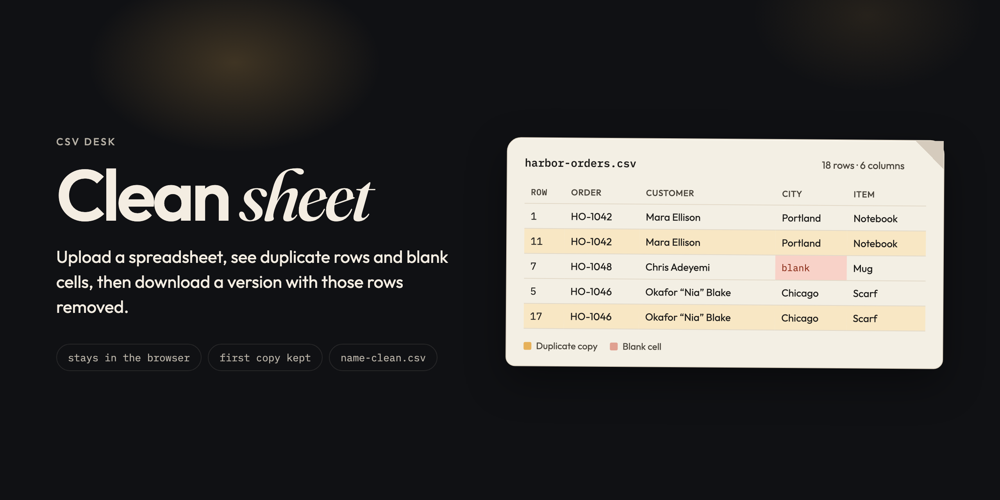
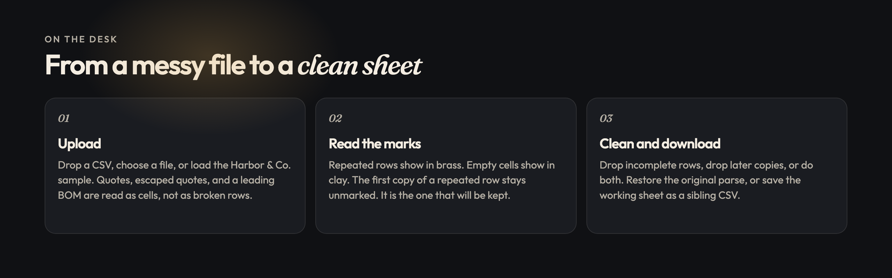

# Clean sheet



A desk for a messy CSV. Drop in a file, see which rows repeat and which cells are blank, then download a sheet with those rows removed. Parsing, the preview, and the download all run in the browser.



## On the desk

The page is one workspace and a dock.

The mast reads **CSV desk** and **Clean sheet**. Until a file is loaded, the empty state offers **Load sample** and **Open upload**. After a file loads, the filename sits in a mono chip, and the desk fills in.

Four figures sit across the top of a loaded sheet:

| Figure | What it counts |
| --- | --- |
| Rows (current) | Rows in the working sheet, after any cleans you have already applied |
| Duplicate rows | Later copies. The first copy of each repeated row is excluded |
| Blank cells | Cells that are empty once surrounding whitespace is trimmed |
| After clean | How many rows **Clean sheet** would leave |

Under that, **Blank cells by column** draws a clay meter for every column that has at least one blank. **Duplicate groups** lists up to five groups, each labeled from the first two filled cells of the kept row, then “and N more” when the sheet has further groups.

The action row is the whole job:

- **Remove duplicates** drops later copies and leaves incomplete rows in place.
- **Remove incomplete rows** drops any row with a blank cell and leaves repeated rows in place.
- **Clean sheet** does both, incomplete rows first.
- **Restore original** puts the working sheet back to the parse you loaded.
- **Download CSV** saves the working sheet.

The dock stays at the bottom. **Upload** and **Preview** open as sheets over a dimmed desk. Escape closes the open sheet and returns focus to the button that opened it. While a sheet is open, the desk behind it is inert.

## Upload

The upload sheet accepts a drop, a file picker (`.csv`, `text/csv`, or `text/plain`), or the built-in sample. A drop on the rest of the window is cancelled, so the browser does not navigate away to the file.

The file is read as text. These parses fail with a specific message:

| Input | Message |
| --- | --- |
| Empty file, or a file that is only a byte-order mark | This file has no rows. |
| A header row whose cells are all blank | This file has no header row. |
| A file the browser cannot read | Could not read that file. |

A successful load replaces the working sheet, clears the preview filter, and opens Preview. The status line reports the filename, the row count, and the column count.

## What the marks mean

A **duplicate** is a later row whose cells match an earlier row in every column. Matching trims each cell before it compares, so `Mug, 2 ` and `Mug,2` are the same row. The stored text of the kept row stays as it was parsed. The label on a group is the first two non-empty cells of that kept row, joined with a middle dot, and cut at 48 characters. A group whose kept row is entirely blank is labeled **Empty row**.

A **blank cell** is a cell that is empty after trim. A cell of only spaces counts. A missing column on a short row is padded to the header width and counts as blank. Cells past the header width are dropped and never marked.

In the preview, a later copy takes a brass row. A blank cell takes a clay cell and the word “blank”. The first copy of a repeated row stays on the plain paper. It is the row **Remove duplicates** will keep.

The **Issues** filter lists a row when it is a later copy or when it contains a blank cell. **All** lists every working row. Cleaning always uses the full working sheet, including rows the preview has not drawn.

The preview draws 250 rows at a time. **Show more** adds another 250. A sheet of 2,000 rows or more stays capped at the first 250 in view. The download still contains every working row.

## The three cleans

**Clean sheet** removes incomplete rows, then removes duplicate copies from what remains. Two identical incomplete rows both leave as incomplete rows. They are not also counted as duplicates.

**Remove duplicates** only drops later copies. Blank cells stay.

**Remove incomplete rows** only drops rows with a blank cell. Later copies of complete rows stay.

Each pass reports how many rows it removed and how many remain. **Restore original** copies the rows from the moment of parse. It does not re-read the file. A second clean runs on the working sheet, so the counts describe that pass, not the file you first opened.

## Harbor & Co.

**Load sample** opens `harbor-orders.csv`: eighteen orders, six columns (`order_id`, `customer`, `city`, `item`, `qty`, `total`). The file is there to show the marks on a sheet small enough to read.

Three orders appear twice. The later copy is the duplicate:

| Kept row | Later copy | Who |
| --- | --- | --- |
| 1 | 11 | HO-1042, Mara Ellison, Portland, Notebook |
| 3 | 15 | HO-1044, Priya Shah, Austin, Tote |
| 5 | 17 | HO-1046, Okafor "Nia" Blake, Chicago, Scarf |

Five cells are blank:

| Row | Column | Order |
| --- | --- | --- |
| 7 | city | HO-1048, Chris Adeyemi |
| 8 | item | HO-1049, Samir Patel |
| 9 | qty | HO-1050, Leah Kim |
| 10 | total | HO-1051, Noah Brooks |
| 12 | customer | HO-1052, a customer cell of only spaces |

Quoted fields in the sample survive as values: `Hale, Jonah`, `Okafor "Nia" Blake`, and `Mina Cho`.

**Clean sheet** on the untouched sample removes the 5 incomplete rows and then the 3 later copies. Ten rows remain, with no blank cells and no later copies. **Remove duplicates** alone leaves 15 rows and the blanks. **Remove incomplete rows** alone leaves 13 rows and the three later copies.

The download is named `harbor-orders-clean.csv`.

## What the file becomes

The parser is a small RFC-style reader for the shapes this desk needs.

- A leading `U+FEFF` byte-order mark is stripped before the first record.
- Records may be separated by `\n`, `\r\n`, or `\r`. A trailing break does not invent an extra row.
- A field in double quotes may contain commas and line breaks. A doubled quote inside quotes is one quote character.
- Header cells are trimmed. Body cells are kept as parsed, including surrounding spaces.
- Each body row is fit to the header width: short rows gain empty cells, long rows lose the extra cells.
- The writer emits CRLF, ends with a trailing break, and quotes a field when it contains a comma, a quote, or a line break. Quotes inside a field are doubled.

`orders.backup.csv` downloads as `orders.backup-clean.csv`. A name with no extension downloads as `name-clean.csv`.

## Stays on this machine

There is no account, no upload endpoint, and no analytics call. The page reads the file with `FileReader`, keeps the rows in memory, and saves the result with a local object URL. Closing the tab drops the sheet.

## Run it

Node is enough. From the repo:

```bash
npm install
npm run dev
```

The desk opens at [http://localhost:5173](http://localhost:5173).

```bash
npm run check
npm run build
```

`check` runs the parser, the sample, and the three clean modes through `src/lib/csv.check.ts`. `build` typechecks with `tsc --noEmit`, then writes `dist/` with Vite. `dist/` and `node_modules/` stay out of git.

## Layout

| Path | Role |
| --- | --- |
| `src/App.tsx` | Sheet state, file loading, clean, restore, download, and which dock sheet is open |
| `src/components/Workspace.tsx` | Mast, empty state, stats, column meters, duplicate groups, actions |
| `src/components/UploadBar.tsx` | Drop target, file picker, sample |
| `src/components/PreviewBar.tsx` | Paper table, All / Issues, the 250-row window |
| `src/components/Dock.tsx` | Upload and Preview |
| `src/components/BarSheet.tsx` | Shared sheet chrome, dark for upload and paper for preview |
| `src/lib/csv.ts` | Parse, analyze, clean, and write |
| `src/lib/sample.ts` | Harbor & Co. orders |
| `src/lib/csv.check.ts` | Assertions for the engine |
| `src/index.css` | The desk, the lamp, the paper, brass, and clay |
| `assets/banners.html` | Source for the pictures in this readme |

## Design

The desk is `#101114`. Type is Outfit for the interface, Fraunces italic for the word *sheet*, and IBM Plex Mono for filenames and counts. A brass lamp sits at the top of the page. Paper is `#f3efe4` with a folded corner, the same sheet as the favicon.

Marks use the preview colors: later copies on `#f8e7c4`, blank cells on `#f8d2c8` with ink `#8c2f1b`. The primary action is brass `#e6b15a` on ink. Focus is a brass outline. The banners at the top of this page are rendered from `assets/banners.html` with those same tokens.

## Stack

React 19, TypeScript, and Vite. The engine has no CSV dependency. The UI has no component library. Both are there so a row either matches or it does not, and the reason is in `src/lib/csv.ts`.
